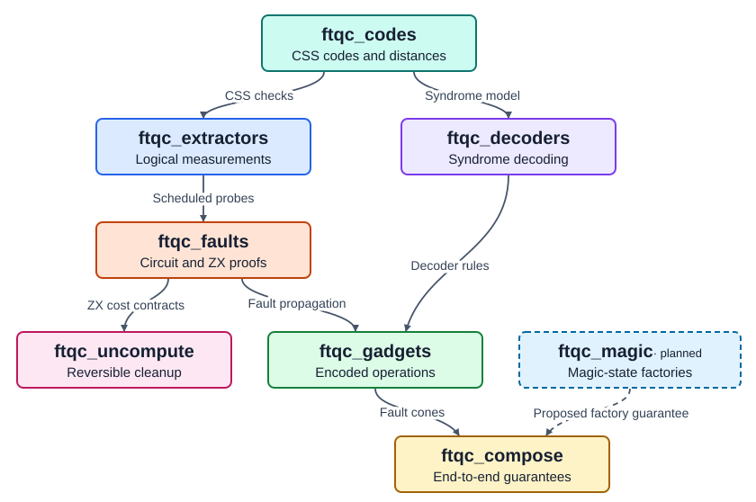

# Fault-tolerant quantum computing in BootLoops

Eight packages check the separate statements that a fault-tolerance argument
for a quantum computer is built from. Each one takes a code, a circuit, a
decoder, a schedule or a factory, answers one kind of question about it
exactly, and writes the answer and its evidence to a JSON receipt that a
verifier replays. Together they do not prove a threshold or an end-to-end
logical error rate for a computation. They check pieces of such an argument
and name every premise that is left.

This page goes from the general to the particular: the argument the tools
check and the conventions they share, what each tool is for, what the tools do
not do, how their receipts connect, and then worked examples from the smallest
to the largest. Inputs, gates and hazards of each package are in its
`GUIDE.md`.

## The argument the tools check

A fault-tolerance argument passes through levels. Each level has its own
statement and its own way of counting how many faults it takes to do harm.

| Level | Typical statement | What is counted | Tool |
|---|---|---|---|
| Code | every nontrivial logical operator has weight at least d | data qubits in a logical Pauli (static distance) | [`ftqc_codes`](ftqc_codes/GUIDE.md) |
| Circuit | no set of fewer than d faulty locations passes every detector and changes a protected result | faulty locations (circuit or fault distance) | [`ftqc_faults`](ftqc_faults/GUIDE.md) |
| Logical operation | a measurement, gate or correction on encoded blocks acts correctly on every input, up to some number of faults | faults plus incoming errors, per block or per coordinate | [`ftqc_extractors`](ftqc_extractors/GUIDE.md), [`ftqc_gadgets`](ftqc_gadgets/GUIDE.md) |
| Decoding | a polynomial-time decoder corrects every pattern up to radius t | the decoder's operational radius | [`ftqc_decoders`](ftqc_decoders/GUIDE.md) |
| Composition | joined operations meet each other's input requirements, and the whole fails with probability at most ε under a stated noise law | bad fault supports, decoding events, tail probabilities | [`ftqc_compose`](ftqc_compose/GUIDE.md) |
| Resources | a factory delivers magic states of a given quality, acceptance and size; a logical circuit restores its scratch qubits | exact output error polynomials; symbolic phase and reset checks | [`ftqc_magic`](ftqc_magic/GUIDE.md), [`ftqc_uncompute`](ftqc_uncompute/GUIDE.md) |

Static distance counts qubits and circuit distance counts locations. One
faulty CNOT is one location even when it leaves errors on both of its qubits,
so a distance-d code can sit inside a schedule whose circuit distance is
smaller than d: the [surface-code example](#find-a-hook-in-a-surface-code-schedule)
gives 3 and 2 for two CNOT orders on the same code. In the same way a code
that can correct t errors can be paired with a practical decoder that corrects
fewer: the [Golay example](#certify-and-break-a-decoder) gives 2 instead of 3.
Each level therefore needs its own check, and the higher levels take receipts
from the lower ones as inputs.

### What every receipt has in common

- **It is bound to its input.** A receipt carries the SHA-256 digest of the
  canonical input. `verify` recomputes the result from the input and refuses a
  receipt whose input, evidence or result has been edited.
- **Bounds are intervals.** An upper end comes with a witness that a separate
  code path replays: a logical operator, a fault set, a failing syndrome. A
  lower end names the argument that proved it: exhaustive enumeration, a SAT
  refutation whose LRAT proof is re-checked by the checker in `ftqc_codes`, a
  structural lemma whose hypotheses are checked on the instance, or, for code
  distance only, a Lean 4 theorem. A value is exact when the two ends meet.
- **A failed claim is a result.** A counterexample exits 1 and is written with
  its witness. A search that runs out of budget leaves the claim open and is
  not a counterexample.
- **Premises are listed.** Ideal boundaries, declared noise laws, supplied
  contracts and theorems quoted from papers are written into the receipt, and
  a result that rests on them is marked conditional.
- **Arithmetic is exact.** Bits over GF(2), integers, rationals and exact
  algebraic numbers in Z[ω₈] and Q(√2). Decimal values are rounded outward:
  upper bounds up, lower bounds down.

The exit codes are shared: 0 proved or verified, 1 counterexample or refused
receipt, 2 malformed input. `ftqc_extractors` and the surgery commands of
`ftqc_gadgets` use 3 for a search that ended without a decision.

### The fault model

A *location* is one preparation, gate, idle or measurement in a scheduled
circuit. A fault there is any nonidentity Pauli after the operation (all 15
two-qubit Paulis after a CNOT belong to one location) or a flipped outcome at
a measurement. The weight of a fault set is its number of locations. Idles
exist only where the schedule writes them. Most circuit results assume an
ideal encoded input and an ideal final syndrome measurement and say so.

For Pauli faults in a Clifford circuit, the effect of a set of faults is the
XOR of the effects of its members. "At most j faults" then means "a sum of at
most j columns" of a binary matrix, and circuit distance becomes a
minimum-weight problem of the same shape as code distance. The enumeration and
SAT machinery of `ftqc_codes` applies to it unchanged. This linearity is what
makes exact answers possible, and its absence is why non-Clifford operations
are handled separately (see the next section but one).

## The eight tools



| Tool | The question it answers | What it returns |
|---|---|---|
| [`ftqc_codes`](ftqc_codes/GUIDE.md) | For a CSS code given by check matrices or a named family: what are n, k, d_X, d_Z and the lightest stabilizers, how was it constructed, which logical basis is in use, and what does a physical Clifford word do to that basis? | distance intervals from seven proof legs; construction, basis and signed-action receipts |
| [`ftqc_faults`](ftqc_faults/GUIDE.md) | In a scheduled Clifford circuit, which fault sets escape the detectors and what do they leave? Is one circuit fault-equivalent to another? | the fault model, circuit and fault distance, strict fault tolerance at low order and a location census (audit engine); fault equivalence, ZX rewrite proofs, flag decoders and stochastic gadget contracts (ZX engine) |
| [`ftqc_extractors`](ftqc_extractors/GUIDE.md) | What logical measurement, logical T or injected state does an apparatus attached to a memory produce, and what distance does it keep? | static, phenomenological and circuit-level receipts for HGP, bivariate bicycle and general CSS memories |
| [`ftqc_gadgets`](ftqc_gadgets/GUIDE.md) | What does a gadget with its decoder do to an arbitrary encoded input carrying incoming errors, under internal faults? | the gate and error-correction properties of Aliferis, Gottesman and Preskill at low order; refinement and composition; coordinate locality for large codes; two-level and purification-tree certificates; fault cones of whole schedules; signed surgery instruments; staged switched-T and pieceable-CCZ gates |
| [`ftqc_decoders`](ftqc_decoders/GUIDE.md) | Does a given polynomial-time decoder correct every pattern up to radius t, and where does it fail? | exact-arithmetic decoders, radius certificates, trapping-set witnesses, logical-error enclosures, audited runs of external decoders |
| [`ftqc_compose`](ftqc_compose/GUIDE.md) | Does one operation's output meet the next one's input requirements, and what failure probability follows under a stated noise law? | typed joins, level reduction, local-stochastic and cone tail bounds, purification-tree contracts, schedule volumes, distillation-to-logical-T bounds |
| [`ftqc_magic`](ftqc_magic/GUIDE.md) | What output quality, acceptance and active qubit count does a magic-state factory or cultivation pipeline have, and may its outputs be used as independent? | exact distillation algebra, recycled check schedules, Clifford-hook cultivation distances, correlation rules for multi-stage pipelines |
| [`ftqc_uncompute`](ftqc_uncompute/GUIDE.md) | Does measurement-based cleanup in a logical reversible circuit preserve its quantum action? Is a pebbling schedule or a superposition mask valid? | exact symbolic checks of Hadamard-measure-reset (HMR) cleanup, block proofs for wide arithmetic, pebbling and mask validators, a rewrite advisor |

`ftqc_faults` holds two engines with their own guides:
[`ftqc_faults.audit`](ftqc_faults/audit/GUIDE.md) (location faults in one
circuit) and [`ftqc_faults.zx`](ftqc_faults/zx/GUIDE.md) (relations between
circuits, after Rodatz, Poór and Kissinger). One battery covers both.

## What the tools do not do

The receipts are only as strong as the statements they check. These are the
gaps to keep in mind before quoting a result.

- **No end-to-end theorem.** Nothing here turns a code, a set of gadgets and a
  noise rate into a proven logical error rate for a whole computation.
  `ftqc_compose` joins receipts and computes bounds, but its larger statements
  rest on arguments quoted from papers or printed in the receipt: level
  reduction (He, Nguyen and Pattison, Theorem 4.11), the composition theorem
  and locality lemma of `ftqc_gadgets`, the fault-cone theorem, the filter rule
  for purification trees. The tools check the hypotheses of these arguments on
  the instance and test their conclusions on small cases. They do not prove
  them. The only machine-checked proofs are the Lean 4 distance theorems of
  `ftqc_codes`, which need a separate Lean-QEC build.
- **Low fault orders.** Circuit and gadget properties hold for every set of at
  most j faulty locations, with j usually one to three. Higher orders are
  reached only through structure: the projected search of the gross-code
  measurement (exact distance 7), counting lemmas for verified-cat meters,
  locality certificates. Beyond the proven order, probabilities come from union
  bounds, which can be loose. The decoded surface-code ZZ measurement below has
  no single-fault failure, and its pair union bound at p = 10⁻⁵ is still
  about 1.2 × 10⁻⁴, because it charges every pair of its 1,542 locations.
- **Ideal boundaries and classical control.** Most circuit receipts start from
  an ideal encoded input and end with an ideal syndrome measurement.
  Classical processing, feed-forward and storage of records are ideal. Decoders
  inside circuit receipts are often lookup tables or postselection.
- **A narrow noise model.** Pauli faults at listed locations, correlated only
  inside one location unless a joint law is supplied. Leakage, loss, coherent
  errors, crosstalk and drift are not modelled. Independence and the
  local-stochastic condition are hypotheses that the user declares; a finite
  law is checked against the condition on up to 16 sites.
- **Non-Clifford steps are special cases.** The circuit engines handle
  Clifford operations and Z feed-forward from one bit. A logical T is checked
  as a channel identity with an ideal or contract-described magic state. The
  staged switched-T and pieceable-CCZ studies are exact through one fault but
  rely on ideal seeds and ideal terminal recovery. Cultivation is analysed by a dedicated simulation of one subcircuit with an
  ideal encoded |T⟩ input. Distillation factories use the standard model of
  independent input errors and ideal Clifford checks. The pipeline composer of
  `ftqc_magic` adds a surface-code error per rotation from the heuristic
  formula 0.1·(100p)^((d+1)/2), which is not derived here.
- **Decoders are certified only at small radius.** A radius certificate checks
  every pattern up to the radius, which is feasible for small radii (277
  patterns on Golay at radius 2). Trapping-set search uses targeted probes and
  is not exhaustive. The connected-cluster bound takes the size of clusters the
  decoder corrects as an input (the field is named `verified_component_radius`
  but nothing verifies it), and it bounds one sector of the static code under
  independent bit flips. On the BB144 example it gives 1.6 × 10⁻¹⁴, against
  1.1 × 10⁻¹⁴ for the plain union bound under the same assumption.
- **Published theorems are dependencies.** Extractor receipts check the finite
  hypotheses of results such as Proposition 3.9 of Cowtan, He, Williamson and
  Yoder or the canonical extractor of Blue et al., then apply them. They do
  not re-derive them.
- **Hardware is an input.** Coupler inventories, placements, durations and
  feed-forward latency are supplied. No receipt uses a calibrated device
  model, and routing and storage for the logical T protocol are not compiled.
- **Codes.** Distance proofs are for binary CSS codes. Signed stabilizer codes
  enter only through action receipts, fixed-coupler extractors and surgery
  instruments. Subsystem and qudit codes are out of scope.
- **Sampling is evidence of another kind.** The tools contain samplers and can
  drive Stim, sinter and external decoders, but threshold sweeps belong
  elsewhere. Sampled histograms are labelled empirical and are not bounds.
- **Speed.** The code is pure Python apart from one C++ search helper and
  optional solvers (CaDiCaL for SAT legs, Stim for cross-checks and some
  studies). Three batteries exceed the toolkit's 20 s standard (see
  [Getting started](#getting-started)).
- **Provenance.** The code was written by Claude under the author's direction.
  The batteries test it against brute force, dense simulation, planted defects
  and, where installed, Stim and CaDiCaL. Comparisons with independent programs
  (PyMatching, ldpc, qLDPC, AutQEC, the Qiskit bicycle compiler) are optional
  and not part of the default batteries.

## Getting started

From the BootLoops root, with Python 3.10 or later:

```sh
export PYTHONPATH="$PWD/tools"
python3 run_selftests.py ftqc_codes ftqc_faults ftqc_extractors ftqc_decoders ftqc_gadgets ftqc_compose ftqc_uncompute ftqc_magic
```

There is one battery entry per tool. Measured on a four-core Linux virtual machine with Python
3.10, without Stim or CaDiCaL:

| Battery | Result | Time |
|---|---|---|
| `ftqc_codes` | 3,188 checks, 2 named skips (SAT, Lean) | 8 s |
| `ftqc_faults` | audit: 5,637 checks, 2 named skips (SAT, Stim); ZX: 10 legs; bridge: 3 tests | 6 s |
| `ftqc_extractors` | 72 tests, 6 skipped | 52 s |
| `ftqc_decoders` | 10 legs | 2 s |
| `ftqc_gadgets` | 6,971 checks | 33 s |
| `ftqc_compose` | 90 tests, 3 skipped | 22 s |
| `ftqc_uncompute` | 22 legs | 3 s |
| `ftqc_magic` | 10 legs | 8 s |

Install Stim and put CaDiCaL on `PATH` (or set `FTQC_CODES_CADICAL`) to run the
skipped legs. The Lean leg has its own prerequisites, given in the
[code guide](ftqc_codes/GUIDE.md). The examples on this page use the shell
setup above and a scratch directory:

```sh
export PYTHONPATH="$PWD/tools"
out=$(mktemp -d)
```

## How the tools connect

Receipts pass from each level to the levels after it. Each arrow in the
figure is a check that the consumer performs on the producer's receipt: the
consumer re-verifies the receipt or rebuilds the evidence it needs.

- **Code to circuit.** `ftqc_faults`, `ftqc_gadgets` and `ftqc_extractors`
  build their circuits from `ftqc_codes` constructions and reuse its GF(2)
  algebra, CNF encoding and LRAT checker. A code receipt supplies the decoding
  radius that a gadget locality certificate then re-proves on the check
  matrix.
- **Logical measurement to circuit audit.** `ftqc_extractors` defines the
  measured logical and its spectators and exports X and Z probe circuits in
  the audit format. The audit engine computes their fault model, and the
  extractor combines both probes into one distance receipt.
  [Comparison guide](ftqc_extractors/AUDIT.md)
- **Circuit to gadget.** `ftqc_gadgets` uses the audit propagator and adds
  encoded Bell inputs, reference qubits and decoders, so that a property holds
  for every input state. Its signed surgery instruments are installed on
  shared hardware by `ftqc_extractors`.
  [Surgery interface](ftqc_gadgets/SURGERY.md)
- **Distance to decoding.** Code and circuit distance describe an ideal
  minimum-weight decoder or postselection. `ftqc_decoders` checks concrete
  decoders against them, supplies procedural decoders to `ftqc_gadgets` where
  lookup tables are too large, repairs noisy surgery syndromes with metachecks
  and estimates decoder stalls for `ftqc_uncompute`.
- **Gadgets to bounds.** `ftqc_compose` reads gadget, extractor and factory
  receipts. It checks typed joins (wires, codes, logical bases, decoders),
  turns the fault cones of a schedule into tail bounds, derives the ancilla
  contracts those bounds need from purification-tree certificates, and prices
  the schedule in physical locations.
- **Factories to consumers.** `ftqc_magic` exports contracts with an explicit
  correlation mode (independent, batch-correlated or catalyst-poisoned).
  `ftqc_compose` and `ftqc_extractors` refuse to treat correlated outputs as
  independent and carry the factory bound into a logical T.
- **Logical circuits to physical audit.** `ftqc_uncompute` lowers the Clifford
  and HMR parts of a logical circuit to the audit and ZX engines, and binds
  wide arithmetic block programs to a correction schedule in the format that
  `ftqc_gadgets cones` reads. Its resource estimate combines logical counts
  with supplied factory, contract and latency numbers.
  [Bridge](ftqc_uncompute/adapters/ftqc_bridge.py)

## Worked examples

The examples start with one code and end with whole schedules and factories.
Each says what the commands report and what the result does not cover.

### Certify a code

```sh
python3 -m ftqc_codes certify steane -o "$out/steane.json"
python3 -m ftqc_codes verify "$out/steane.json" --full
python3 -m ftqc_codes certify qr:47 -o "$out/qr47.json"
python3 -m ftqc_codes verify "$out/qr47.json" --full
```

Steane has n = 7, k = 1, d = 3 and lightest stabilizers of weight 4. The
[[47,1,11]] quadratic-residue code has d = 11 and lightest stabilizers of
weight 12. Both distances are proved by exhaustive information-set
enumeration (leg A), and `--full` repeats it. Every upper end is a logical
operator that `verify` checks with dot products. For codes beyond enumeration
the receipt falls back to the BCH bound, disjoint logical cuts or the
concatenation product bound, and records which one was used.

### Find a hook in a surface-code schedule

```sh
python3 -m ftqc_codes certify rotated_surface:3 -o "$out/code.json"
python3 -m ftqc_faults audit analyze surface:3,2,z -o "$out/standard.json"
python3 -m ftqc_faults audit analyze surface:3,2,z,bad -o "$out/hook.json"
```

The distance-3 rotated surface code has static distance 3. Two rounds of
syndrome extraction (174 locations) with the standard CNOT order have circuit
distance 3. With the hook-aligned order (`bad`) the circuit distance is 2, and
the receipt gives a two-fault set that passes all 16 detectors and flips the
logical. The rounds are noisy, the encoded input and final measurement are
ideal, and only the idles of the library circuit are counted.

The sector decoder looks at the same memory with decoding in place of
postselection:

```sh
python3 -m ftqc_decoders.surface_memory --distance 3 --rounds 3 --basis Z
```

It projects each physical single fault onto the measured sector and decodes
it with equal-weight matching. None of the 1,554 single-location fault modes
of the three-round memory is decoded wrongly. That is a statement about single
faults only.

### Compare two circuits: the five-ancilla Steane extractor

```sh
python3 -m ftqc_faults zx equiv steane_5anc steane_spec --w 3 --noise-model circuit_css --code steane_7_1_3
python3 -m ftqc_faults steane -o "$out/steane-bridge.json"
python3 -m ftqc_faults steane --verify "$out/steane-bridge.json"
```

The first command shows that the 15-CNOT, five-ancilla X-syndrome extractor
of Rodatz, Poór and Kissinger is 3-fault-equivalent to its specification on
the Steane codespace. It counts X and Z faults separately (`circuit_css`). Under
joint counting, where one CNOT fault with X on one qubit and Z on the other
has weight two, the construction is not claimed, and the receipt records the
model used. The bridge then checks the two engines against each other on the
physical schedule: each sector has 95 noisy locations, and for all 455
single-location fault modes the ZX propagator and the audit engine must agree
on the detectors, all five raw measurement records and the output Pauli.
[Model, boundaries and fault weights](ftqc_faults/GUIDE.md#five-ancilla-steane-extractor)

### Check a gadget on unknown inputs

```sh
python3 -m ftqc_gadgets analyze knill:steane,anc=spec --check ec:1 --close 1 -o "$out/gadget.json"
python3 -m ftqc_gadgets verify "$out/gadget.json" --full
```

Teleportation-based (Knill) error correction on Steane, with its two ancillas
given as specifications, has the error-correction properties through order
one. For any input and one fault or one incoming error, the output is within
the fault weight of the ideal state; for any input whatever, one fault leaves
the output within weight one of the code space. The input enters as half of
an encoded Bell pair, which makes "for every input" a property of one
stabilizer state.

Enumeration does not reach the radius of QR-47. The locality certificate
proves instead that every fault and every incoming error stays on its own
coordinate, and it re-proves the decoder radius on the check matrix:

```sh
python3 -m ftqc_gadgets analyze steane_ec:qr:47,anc=spec --local --code-receipt "$out/qr47.json" --no-tables -o "$out/outer.json"
python3 -m ftqc_gadgets verify "$out/outer.json"
```

The receipt states that the gate, error-correction and any-input properties
hold whenever faults and input errors touch at most five of the 47
coordinates, however many faults lie inside them. The step from locality to
those properties is a lemma printed in the receipt. With each coordinate read
as a column of inner blocks, this is the outer half of a two-level argument,
which `ftqc_gadgets/levels.py` joins to inner receipts.

The ancillas of that gadget are specifications. A purification tree that
makes one is certified separately:

```sh
python3 -m ftqc_gadgets analyze prep:qr:47,zero,tree=XZXZ,rounds=2 --tree --strict --light --wmin 11 -o "$out/zero.json"
python3 -m ftqc_gadgets verify "$out/zero.json"
```

The 16-leaf tree (8,867 locations) acts as its specification, with wire faults
only on coordinates of failed local and check locations, unless four leaves in
one sector hold a fault that can spread. `levels.reduction(..., factories=...)`
then lists no ancilla as assumed and records that count. The probability of
that junk event is a separate calculation (`Tree.bounds`, or the
`filter-contract` study below).

### Certify and break a decoder

```sh
python3 -m ftqc_decoders certify-radius --code golay --decoder bp_osd --osd-order 2 --radius 2 -o "$out/golay2.json"
python3 -m ftqc_decoders certify-radius --code golay --decoder bp_osd --osd-order 2 --radius 3 -o "$out/golay3.json"
python3 -m ftqc_decoders verify "$out/golay3.json"
```

The Golay code [[23,1,7]] can correct three errors. BP+OSD of order two
corrects all 277 X-sector patterns of weight at most two. The second command
finds a weight-three pattern that it decodes to a logical error, exits 1 and
writes the witness. The operational radius of this decoder on this code is
two.

```sh
python3 -m ftqc_decoders check tools/ftqc_decoders/examples/bb72_trapping_set.json -o "$out/bb_ts.json"
python3 -m ftqc_decoders verify "$out/bb_ts.json"
python3 -m ftqc_decoders check tools/ftqc_decoders/examples/bb144_peierls_cluster.json -o "$out/bb144_ler.json"
python3 -m ftqc_decoders verify "$out/bb144_ler.json"
```

On the [[144,12,12]] gross code (the first input keeps an older file name; its
`problem.kind` is `bb144`), plain belief propagation does not converge on a
weight-three half of a weight-six stabilizer, and Relay-BP, BP+LSD and BP+OSD
each correct it. This is one witness, not a radius certificate. The second
receipt bounds the X-sector logical error rate at p = 10⁻⁴ under two
assumptions it prints: disjoint fault clusters decode independently, and every
connected cluster of at most five faults is corrected. The second is an input.
[Known gaps](ftqc_decoders/GUIDE.md#known-gaps)

### Measure a logical qubit of a qLDPC memory

```sh
spec=tools/ftqc_extractors/examples/gross-circuit.json
python3 -m ftqc_extractors check "$spec" -o "$out/distance.json"
python3 -m ftqc_extractors verify "$spec" "$out/distance.json"
python3 -m ftqc_extractors schedule "$spec" --probe Z -o "$out/z-probe.json"
python3 -m ftqc_faults audit records "$out/z-probe.json" -o "$out/records.json"
```

This is the unprimed logical Z measurement of the bivariate bicycle gross
code with the 18-edge partial extractor of Cross, He, Rall and Yoder, compiled
to a seven-round schedule on 319 qubits. The merged [[162,11,12]] code keeps
static distance 12. Each of the two CSS probes has 25,048 noisy locations. The
receipt proves exact circuit distance **7**: a projected search excludes every
harmful set of at most six faults in both probes, and flipping one port
measurement in every round changes the logical result while passing every
detector. With twelve rounds the exact distance is 10; that run needs a
larger search budget and supplied witnesses
([details](ftqc_extractors/GROSS_CIRCUIT.md)). The schedule, its barriers and
idle placement are choices of this implementation, and the input and the final
test measurements are ideal.

For two BB144 memories, a full transversal reading measures twelve
independent parities of corresponding logical qubits with 72 added data
qubits and 144 check meters. With twelve syndrome rounds on each side,
Proposition 3.9 of Cowtan, He, Williamson and Yoder gives phenomenological
distance at least 12. A separate one-merge-round circuit with ideal inputs and
terminal measurements has circuit distance between 3 and 12 in both probes;
the gap is open. [BB144 benchmark](ftqc_extractors/GUIDE.md#two-block-bb144-benchmark)

### Lattice surgery on surface-code patches, decoded and priced

```sh
for axis in xx zz; do
    python3 -m ftqc_extractors.surgery_bench "surface-$axis" -o "$out/$axis.json"
    python3 -m ftqc_extractors check "$out/$axis.json" -o "$out/$axis-proof.json"
    python3 -m ftqc_extractors verify "$out/$axis.json" "$out/$axis-proof.json"
done
```

Two distance-three rotated patches are merged with nearest-neighbour
couplers: one split-code round, three merged rounds, three split rounds. For
each axis the receipt checks that every ideal measurement branch measures the
signed parity and preserves the named surviving logical pair, excludes all
one- and two-location faults, and replays a three-fault witness, so the
circuit distance is exactly 3. The ZZ schedule has 67 ticks, 54 couplers and
at most 35 live qubits. To price the decoded measurement, pass the installed
gadget to `ftqc_compose`:

```sh
python3 - "$out" <<'PY'
import json, pathlib, sys
d = pathlib.Path(sys.argv[1])
gadget = json.loads((d / "zz-proof.json").read_text())["result"]["gadget"]
study = dict(kind="decoded-surgery", receipt=gadget, incoming_weight=0, p="1/100000")
(d / "channel.json").write_text(json.dumps(study))
PY
python3 -m ftqc_compose check "$out/channel.json" -o "$out/bound.json"
python3 -m ftqc_compose verify "$out/channel.json" "$out/bound.json"
```

The decoder is one syndrome table over all 8,644 single-location alternatives
of the 1,542 locations, and none of them causes a wrong public bit or a
residual error. Every higher order is charged by a pair union bound, which
gives 1188111/10¹⁰ ≈ 1.2 × 10⁻⁴ at p = 10⁻⁵ for the public bit, for the
residual and for both together. The bound assumes a clean encoded input and
independent locations.

### Trace a fault through a correction schedule

A decoder sees the faults that can reach its block and Pauli sector by the
time it runs. `ftqc_gadgets cones` follows these sources through transversal
gates, idles, measurements and corrections, at one or two levels of
concatenation:

```sh
python3 -m ftqc_gadgets cones tools/ftqc_gadgets/examples/two-level-cones.json -o "$out/cones.json"
python3 -m ftqc_gadgets verify "$out/cones.json"
```

The seven-layer example has eight inner and four outer decoding events. In
the X sector the outer correction sees inner events 0 and 2, and the output
after it sees events 2, 4 and 6: the earlier error stops contributing once the
correction succeeds. Verification recomputes the cones and checks that linear
propagation stays inside them for ten settings of the classical controls.

Three `ftqc_compose` studies continue from there. `cone-bound` turns cones
into a conditional bound on decoding failure from a decoder radius, a noise
model and ancilla contracts. `filter-contract` derives those contracts from a
certified purification tree, conditioned on acceptance; the banked 64-leaf
Golay tree at p = 10⁻⁴ has acceptance lower bounds between 0.91 and 0.97 at
its six levels. `volume` prices a schedule in expected physical locations; the
banked two-level example totals 65,578.

```sh
python3 -m ftqc_compose check tools/ftqc_compose/examples/filter-contract-golay.json -o "$out/filter.json"
python3 -m ftqc_compose check tools/ftqc_compose/examples/volume-two-level.json -o "$out/volume.json"
```

The cone theorem, the filter rule and the independence of columns are
premises of these receipts.
[Tail bounds](ftqc_compose/GUIDE.md#tail-bounds-over-fault-cones) ·
[Filter calculus](ftqc_compose/GUIDE.md#filter-calculus-for-purification-trees) ·
[Volume](ftqc_compose/GUIDE.md#volume-of-a-schedule)

### Carry a distillation bound into a logical T gate

```sh
python3 -m unittest ftqc_compose.test_logical_t
```

A correcting 15-to-1 factory feeds an eight-qubit HGP memory through a CSS
encoder into the extractor's logical T gate. `ftqc_compose` checks all four
adaptive measurement branches with exact eighth-root phases. With fault-free
encoding and consumption it bounds half the diamond distance of the logical
channel by 21/2000, the factory bound min(1, 105p²) at p = 1/100. The encoder
alone has accepted fault distance one: a Z fault on the raw control after its
first fan-out CNOT becomes a logical Z. The test also exercises separate
encoder and gate fault rates.
[Logical T study](ftqc_compose/GUIDE.md#from-a-distilled-qubit-to-logical-t)

### Direct switched T and pieceable CCZ

```sh
python3 -m ftqc_gadgets staged tools/ftqc_gadgets/examples/staged-pieceable-ccz.json -o "$out/ccz.json"
python3 -m ftqc_gadgets verify "$out/ccz.json"
study=tools/ftqc_compose/examples/switched-t.json
python3 -m ftqc_compose check "$study" -o "$out/t.json"
python3 -m ftqc_compose verify "$study" "$out/t.json"
```

These two studies implement non-Clifford logical gates without magic states.
The first raises an unknown Steane qubit into the 15-qubit punctured
Reed–Muller code by gauge measurement, applies transversal T† and lowers it
again (Anderson, Duclos-Cianci and Poulin). The second applies CCZ to three
Steane blocks in four pieces of 9, 6, 6 and 6 gates, with syndrome readings
between the pieces (Yoder, Takagi and Chuang). `ftqc_gadgets` checks the
action on every basis column with a common phase, so coherence with a
reference is kept, and shows that every single fault is recovered; the CCZ
schedule has at most 3,645 locations. `ftqc_compose` joins the three stages
of the switched T. If every pair of locations is jointly faulty with
probability at most p², summing the pairs of each stage bounds its failure by
44431/10¹² at p = 10⁻⁶. Cat seeds, the eight-site seed of the Reed–Muller
extension, classical control and the final syndrome measurement and recovery
are ideal services whose own circuits are not certified.
[Protocols, model and replay](ftqc_gadgets/STAGED.md)

### Certify a recycled factory and a flagged cultivation pipeline

```sh
ex=tools/ftqc_magic/examples
python3 -m ftqc_magic check $ex/bh49_recycled_5qubits.json -o "$out/bh49.json"
python3 -m ftqc_magic verify $ex/bh49_recycled_5qubits.json "$out/bh49.json"
python3 -m ftqc_magic check $ex/flagged_cultivation_caliper_15to1.json -o "$out/pipe.json"
python3 -m ftqc_magic verify $ex/flagged_cultivation_caliper_15to1.json "$out/pipe.json"
```

The Bravyi–Haah 49-to-1 factory has distance 5 and leading error 1411p⁵.
Measuring and resetting check qubits in the middle of the circuit reduces its
14 logical wires to 5 active qubits. Its premises are independent input
errors of rate p and ideal Clifford checks.

For magic-state cultivation (MSC-3), an exact simulation of the Clifford
errors H± = (X ± Y)/√2 that arise when a Pauli fault passes a T check finds
four weight-two fault sets that corrupt |T⟩ undetected. A Clifford |S⟩ proxy
of the same schedule has distance 3, but the unflagged |T⟩ distance is 2. With
two Z-flag qubits the |T⟩ distance is 3. The pipeline example chains the
flagged stage, an open-boundary escape stage and a recycled 15-to-1 factory.
Its receipt lists the premises: an ideal encoded [[7,1,3]] |T⟩ input to the
final checks, depolarizing circuit noise inside the cultivation subcircuit,
supplied escape continuation probabilities (used for the cost), ideal Clifford
checks in distillation, and the heuristic surface-code error per rotation
named above. [Magic guide](ftqc_magic/GUIDE.md)

### Certify and simplify measurement-based uncomputation

```sh
dqi=tools/ftqc_uncompute/examples/dqi_rs_tiny_mbuc.kmx
python3 -m tools.ftqc_uncompute check "$dqi" -o "$out/dqi.json"
python3 -m tools.ftqc_uncompute verify "$out/dqi.json" --target "$dqi"
python3 -m tools.ftqc_uncompute pebble --length 12 --mode kmrv -o "$out/pebble12.json"
python3 -m tools.ftqc_uncompute check "$out/pebble12.json" -o "$out/pebble12.receipt.json"
python3 -m tools.ftqc_uncompute blocks tools/ftqc_uncompute/examples/block_adder_4bit.json -o "$out/add4.json"
```

The bilinear circuit over GF(2³) erases a scratch product with HMR. The
symbolic check proves that scratch is restored, resets are clean, every
measurement branch is injective, public outputs do not depend on the
outcomes, and every outcome-dependent phase is cancelled. If the proof exceeds
its budget or cannot settle injectivity, `check` refuses. Trajectory sampling
and the small dense Kraus check are separate fields of the receipt, the first
statistical and the second numerical. A 16-bit ripple adder already exceeds
the global budget. The `blocks` command proves such programs locally, states
the arithmetic as an exact integer relation and binds the program to a
correction schedule in the format of `ftqc_gadgets cones`. Everything here is
at the logical level, with classical control and AND resources ideal.
[Cuts and block programs](ftqc_uncompute/GUIDE.md#wide-arithmetic-cuts-and-block-programs)

## Code automorphisms

An action receipt names a memory, an ordered logical basis, a physical
Clifford word and the signed image of every logical X and Z. A push
permutation sends site `q` to `perm[q]`, and layers run in list order. A
virtual relabelling or change of logical frame carries no timing or distance
evidence. Each physically installed two-qubit gate needs a coupler.

```sh
ex=tools/ftqc_codes/examples
python3 -m ftqc_codes verify "$ex/steane.qldpc-h.action.json" --code steane
python3 -m ftqc_codes verify "$ex/five_qubit.autqec.action.json" --code "$ex/five_qubit.stabilizer.json"
gb='bb:9,1,x0+x1,x1+x2+x3+x5+x7+x8'
python3 -m ftqc_codes action "$gb" "$ex/gb18-fold.steps.json" -o "$out/fold.json"
python3 -m ftqc_codes verify "$out/fold.json" --code "$gb"
```

The first two receipts were produced by external discovery programs and are
replayed here. The third is a phase fold on the 18-qubit generalized bicycle
code built from the first polynomial pair of Table 4 of the GBAutomorphisms
examples: an involution with CZ on each two-cycle and S on each fixed point,
followed by Z on sites 1, 3, 4 and 7. It preserves the signed checks and maps
the two logical X generators to +XZ and −ZX. The CZ layer alone fails signed
replay. List fixed sites under `sdg` to use the inverse phase there. A steps
file `{"actions":[...],"word":[0,{"inverse":0}]}` composes verified generators
(indexed from zero) into one action. A non-CSS code uses schema
`ftqc_codes-stabilizer-1` with an integer `n`, signed Pauli `checks` and
ordered `slots` with `name`, `x` and `z`.
[GBAutomorphisms Table 4 input](https://github.com/ajdav136/GBAutomorphisms/blob/4fc6b77ec17bb9f43de381384a9228f83fde52ce/Examples_table4.ipynb)

Reaching a logical state and installing the operation are different claims.
Logical H on Steane sends +Y to −Y, and seven parallel Hadamards implement it
in one tick:

```sh
python3 - "$ex/steane.qldpc-h.action.json" "$out" <<'PY'
import json, sys
from pathlib import Path
a = json.loads(Path(sys.argv[1]).read_text())
out = Path(sys.argv[2])
orbit = dict(schema=1, kind="action_orbit", code="steane", basis=a["basis"],
             actions=[a], seed="+Y", targets=["-Y", "+X"])
install = dict(kind="installed-action", code="steane", action=a, width=7,
               ticks=[[["H", q] for q in range(7)]], couplers=[])
for name, spec in [("orbit", orbit), ("route", install)]:
    (out / (name + ".json")).write_text(json.dumps(spec))
PY
python3 -m ftqc_extractors check "$out/orbit.json" -o "$out/orbit-proof.json"
python3 -m ftqc_extractors verify "$out/orbit.json" "$out/orbit-proof.json"
python3 -m ftqc_gadgets installed-action "$out/route.json"
python3 -m ftqc_compose check "$out/route.json" -o "$out/route-proof.json"
python3 -m ftqc_compose verify "$out/route.json" "$out/route-proof.json"
```

The orbit receipt reaches −Y with a one-generator word and proves +X
unreachable under the supplied generators. The installed route has 21
single-location faults, each leaving data weight one. A circuit distance would
also need a detection or recovery protocol.

The same receipts drive two larger comparisons in the batteries. On LP(8,4) a
translated seed and ordinary surgery both measure positive Z on slots q2 then
q3; in the installed model the translation uses 42 couplers and admits a
single fault that leaves a residual on the data, while ordinary surgery uses
six couplers and passes the distance-two check. On BB144 the 12-by-6 physical
translations induce 36 distinct signed logical actions, each generator of
order six, as in the shift group of the Qiskit bicycle compiler.
[Gross shift group](https://github.com/qiskit-community/bicycle-architecture-compiler/blob/ad97e823fc4077a9ee3d5fe57cabc25b6d9201d6/crates/bicycle_common/src/lib.rs)

### Optional discovery and comparisons

Native verification uses only the Python standard library. Run the optional
producers in separate environments with `PYTHONPATH` unset, so that the
BootLoops `galois` package does not shadow the PyPI one. The examples assume
that the named interpreters point to those environments.

```sh
env -u PYTHONPATH "$QEC_PYTHON" tools/ftqc_codes/producers/discover_actions.py qldpc steane "$out/qldpc" --gates H
env -u PYTHONPATH "$QEC_PYTHON" tools/ftqc_codes/producers/discover_actions.py autqec "$ex/five_qubit.stabilizer.json" "$out/autqec"
env -u PYTHONPATH "$QEC_PYTHON" tools/ftqc_compose/compare_autdec.py
env -u PYTHONPATH "$BICYCLE_PYTHON" tools/ftqc_compose/compare_bicycle_compiler.py --table "$out/table_gross.dat"
```

- qLDPC 0.2.9 with GAP 4.15.1 and GUAVA 3.20 found one transversal H generator
  on Steane, and five generators in a separate SWAP-only search. AutQEC 1.0.1
  with igraph/Bliss found five candidates on the five-qubit code. For up to six
  independent checks the Bliss adapter uses all unsigned stabilizers; above
  that it searches symmetries of the supplied generating set. Stim checked
  every physical X and Z generator against each exported circuit. Neither
  output claims a complete group.
  [qLDPC](https://github.com/qLDPCOrg/qLDPC) ·
  [AutQEC](https://github.com/hsayginel/autqec/tree/db614a9bfc91f384d324a647557aa9213c6cdc3b) ·
  [Stim](https://github.com/quantumlib/Stim)
- On all 22 Steane inputs of weight zero or one, with one order-three
  mechanism permutation and its identity control, the native BP+OSD ensemble
  had no logical failures, and the upstream BPOSD and its ensemble had three
  each (LDPC 2.1.2, ten iterations, OSD order zero). These are finite counts
  for the stated implementations.
  [AutDEC](https://github.com/hsayginel/autdec/tree/00746ced028ebc6edca1b4e56ee6db3d9039d553)
- The Bicycle Architecture Compiler 0.1.0 with Qiskit 2.6.2 compiled the same
  15 Pauli rotations for the gross code with 15 T injections, 105 measurements
  and 112 automorphisms. The BootLoops installed factory uses 56 shift and
  return generators, or 336 CX ticks, for its gross-port movement alone. Each
  count covers its own stated operations.
  [Bicycle Architecture Compiler](https://github.com/qiskit-community/bicycle-architecture-compiler)

## Addressable high-rate blocks and single-slot Magic delivery

`ftqc_codes` emits construction and basis receipts that bind ordered
matrices, named symplectic logical slots, stabilizer dressings and lift
symmetries for lifted-product, two-block group algebra, quantum Tanner,
radial and pair-partition codes. `ftqc_extractors.addressable_surgery`
installs signed slot measurements and classical feed-forward on an explicit
coupler inventory, and `ftqc_compose.addressable_magic` delivers a verified
single-output T state into a named slot while preserving the other data slots
and their Bell references.

```sh
python3 -m ftqc_codes construct pp256 -o "$out/pp256.construct.json"
python3 -m ftqc_codes basis lp6_2 --method spectral -o "$out/lp6_2.basis.json"
python3 -m unittest ftqc_extractors.test_highrate_qec ftqc_compose.test_addressable_magic
```

Published distances of these families that exceed the search budget stay
under `paper_claims` in the construction receipt and are not used as proved
bounds.

## Supply states from inside a CSS memory

The simultaneous injection checker of `ftqc_extractors` verifies a fresh CSS
source from the signed logical action on its carriers, following Liu et al.
Its BB144 and HGP225 inputs include the first-round selection mask of each
published circuit. Four closed Y probes use the native fault propagation and
Stim, with optional BP+OSD sampling. The two-output S consumer study of
`ftqc_compose` (it needs Stim) conditions the joint error distribution on
batch acceptance. Sampled histograms reproduce published figures but do not
certify a noisy T source. [Injection study](ftqc_extractors/INJECTION.md) ·
[Batch contract](ftqc_compose/GUIDE.md#simultaneous-y-source-and-ideal-consumers)

## Run all FTQC batteries

```sh
python3 run_selftests.py ftqc_codes ftqc_faults ftqc_extractors ftqc_decoders ftqc_gadgets ftqc_compose ftqc_uncompute ftqc_magic
```

The `ftqc_faults` entry runs both engine batteries and the cross-engine
checks.

CREDIT: each package's `GUIDE.md` names the papers and programs it follows,
and bracketed keys resolve in [`REFERENCES.md`](../REFERENCES.md). Treating
fault tolerance as properties over fault counts follows Aliferis, Gottesman
and Preskill and Chen et al.; fault equivalence follows Rodatz, Poór and
Kissinger; typed composition follows He, Nguyen and Pattison.

## License

MIT License. Copyright (c) 2026 Anthropic, PBC. Created by Matthew D. Schwartz;
code written by Claude (Anthropic) under his supervision. Documentation is
licensed CC BY 4.0. See LICENSE, LICENSE-CONTENT and NOTICE at the repository
root.
